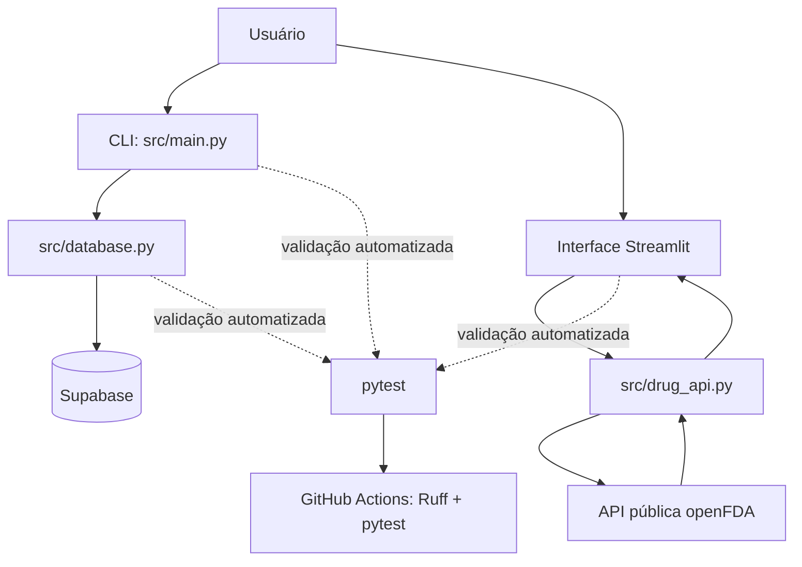

# CheckorKaput

[](https://github.com/gianluca-berria/CheckorKaput/actions/workflows/ci.yml)

Aplicação em Python para auxiliar no cadastro e acompanhamento de medicamentos e permitir consultas informativas a uma fonte pública de dados.

- **Aplicação web:** https://checkorkaput-fw7oxgsm84l32czslsqjtk.streamlit.app/
- **Especificação técnica:** [docs/SPEC.md](docs/SPEC.md)
- **Execuções da integração contínua:** [GitHub Actions](https://github.com/gianluca-berria/CheckorKaput/actions)

> **Aviso:** as informações da consulta são apenas informativas. O CheckorKaput não fornece diagnóstico, prescrição ou recomendação de tratamento e não substitui a orientação de um profissional de saúde.

## Sumário

- [Visão geral](#visão-geral)
- [Funcionalidades](#funcionalidades)
- [Equipe](#equipe)
- [Tecnologias e requisitos](#tecnologias-e-requisitos)
- [Arquitetura](#arquitetura)
- [Instalação e configuração local](#instalação-e-configuração-local)
- [Execução da aplicação](#execução-da-aplicação)
- [Testes e qualidade](#testes-e-qualidade)
- [Docker](#docker)
- [Integração contínua](#integração-contínua)
- [Governança e processo de desenvolvimento](#governança-e-processo-de-desenvolvimento)
- [Decisões arquiteturais](#decisões-arquiteturais)
- [Limitações conhecidas](#limitações-conhecidas)
- [Referências](#referências)

## Visão geral

O CheckorKaput possui dois fluxos principais:

1. **CLI (linha de comando):** cadastra, lista e remove medicamentos, registra tomadas e consulta o histórico. Os dados são persistidos no Supabase.
2. **Interface web em Streamlit:** consulta informações sobre medicamentos pela API pública [openFDA](https://open.fda.gov/apis/drug/label/).

Os dois fluxos têm finalidades distintas: a CLI gerencia os registros pessoais de medicamentos, enquanto a interface web realiza uma consulta informativa à API externa.

## Funcionalidades

### CLI

- Cadastrar medicamento com nome e um ou mais horários.
- Validar nome e horários no formato `HH:MM`.
- Listar medicamentos cadastrados.
- Registrar a tomada de um medicamento.
- Remover medicamento.
- Consultar o histórico de tomadas.
- Persistir medicamentos e registros de tomada no Supabase.

### Interface Streamlit

- Consultar medicamento pelo nome genérico.
- Exibir, quando disponíveis, nome genérico, nome comercial, fabricante, tipo de produto e avisos.
- Informar quando o medicamento não é encontrado ou quando determinados campos não estão disponíveis.
- Apresentar mensagens de erro quando a consulta à API falhar.

## Equipe

- **Gianluca Berria** — [GitHub](https://github.com/gianluca-berria)
- **Emmanuel Avelino** — [GitHub](https://github.com/DevManell)

## Tecnologias e requisitos

- Python 3.12
- Streamlit
- Supabase (persistência da CLI)
- Requests (requisições HTTP à openFDA)
- pytest (testes automatizados)
- Ruff (análise estática/lint)
- Docker (ambiente reproduzível)
- GitHub Actions (integração contínua)

Para executar localmente, instale Git e Python 3.12. Para os comandos em contêiner, instale Docker Engine ou Docker Desktop.

## Arquitetura

### Responsabilidades dos componentes

| Componente | Responsabilidade |
|---|---|
| `src/main.py` | Menu e interação da CLI com o usuário. |
| `src/database.py` | Acesso ao Supabase para cadastrar, listar, remover medicamentos e registrar/consultar tomadas. |
| `streamlit_app.py` | Interface web de consulta informativa. |
| `src/drug_api.py` | Requisição à API openFDA e normalização dos dados retornados. |
| `tests/` | Testes unitários, casos de borda e testes de integração. |
| `src/reminder.py` | Implementação legada de manipulação de medicamentos em memória. |
| `src/storage.py` | Implementação legada de persistência em JSON. |
| `data/meds.json` | Arquivo de dados legado, mantido no repositório. |

Os módulos `src/reminder.py` e `src/storage.py`, assim como `data/meds.json`, pertencem à implementação anterior. A persistência principal utilizada pela CLI atual é o Supabase.

### Diagrama do fluxo da aplicação



A especificação de requisitos, regras de negócio e contratos dos componentes está em [docs/SPEC.md](docs/SPEC.md).

## Instalação e configuração local

### 1. Clonar o repositório

```bash
git clone https://github.com/gianluca-berria/CheckorKaput.git
cd CheckorKaput
git switch develop
```

Se a equipe estiver trabalhando em outra branch de integração, utilize a branch definida no Pull Request correspondente.

### 2. Criar e ativar o ambiente virtual

**Windows PowerShell:**

```powershell
py -3.12 -m venv .venv
.\.venv\Scripts\Activate.ps1
```

Se o PowerShell bloquear a ativação do ambiente virtual, consulte a política de execução da sua máquina ou execute os comandos usando o interpretador do ambiente virtual diretamente.

**Linux/macOS:**

```bash
python3.12 -m venv .venv
source .venv/bin/activate
```

### 3. Instalar as dependências

```bash
python -m pip install --upgrade pip
python -m pip install -r requirements.txt
```

## Configuração das variáveis de ambiente

A CLI utiliza duas variáveis para conectar ao Supabase:

- `SUPABASE_URL`: URL do projeto Supabase.
- `SUPABASE_KEY`: chave de acesso configurada para o projeto.

Não coloque valores reais de chaves ou tokens no README, no código-fonte ou em commits. O repositório inclui regras de `.gitignore` para não versionar `.env` e `.streamlit/secrets.toml`.

### Opção A — arquivo `.env` para Docker

Crie um arquivo chamado `.env` na raiz do projeto, sem adicionar esse arquivo ao Git:

```dotenv
SUPABASE_URL=https://SEU-PROJETO.supabase.co
SUPABASE_KEY=SUA_CHAVE_SUPABASE
```

Substitua os valores ilustrativos pelas credenciais do ambiente que você tem autorização para utilizar. O arquivo `.env` é lido pelo Docker quando se passa `--env-file`; ele **não é carregado automaticamente pelo Python** na execução local.

### Opção B — Windows PowerShell

Defina as variáveis na sessão atual do PowerShell antes de iniciar a CLI:

```powershell
$env:SUPABASE_URL = "https://SEU-PROJETO.supabase.co"
$env:SUPABASE_KEY = "SUA_CHAVE_SUPABASE"
```

Essas definições valem para a sessão atual. Evite colar credenciais em capturas de tela, mensagens públicas ou arquivos versionados.

### Opção C — Linux/macOS

```bash
export SUPABASE_URL="https://SEU-PROJETO.supabase.co"
export SUPABASE_KEY="SUA_CHAVE_SUPABASE"
```

A camada de banco de dados também procura os valores em `st.secrets` quando executada em contexto Streamlit. Para a CLI, configure as variáveis de ambiente antes da execução.

> **Banco de dados:** o projeto Supabase precisa estar configurado com as tabelas e colunas utilizadas pelo código. A aplicação acessa as tabelas `medicamentos` e `registros_tomada`; confira o esquema esperado e as regras relacionadas na [especificação](docs/SPEC.md) e na configuração do projeto.

## Execução da aplicação

Execute os comandos na raiz do repositório, com o ambiente virtual ativado e as dependências instaladas.

### CLI

Configure `SUPABASE_URL` e `SUPABASE_KEY` e execute:

```bash
python -m src.main
```

O menu permite adicionar, listar, marcar como tomado, remover medicamentos, consultar o histórico e sair.

### Interface web Streamlit

```bash
streamlit run streamlit_app.py
```

Por padrão, o Streamlit disponibiliza a aplicação em http://localhost:8501. Informe o nome genérico de um medicamento, por exemplo `acetaminophen`, e clique em **Consultar medicamento**. Essa funcionalidade depende da disponibilidade da API openFDA e de conexão à internet.

## Testes e qualidade

Execute os comandos na raiz do projeto, após instalar as dependências.

### Suíte de testes

```bash
python -m pytest -q
```

Para gerar um relatório compatível com o workflow de CI:

```bash
python -m pytest -q --junitxml=test-results.xml
```

### Ruff

```bash
python -m ruff check .
```

Se o Ruff indicar problemas, revise as mensagens e corrija o código antes de abrir ou atualizar o Pull Request. Não altere testes apenas para mascarar uma falha real da implementação.

## Docker

O `Dockerfile` usa `python:3.12-slim`, instala as dependências de `requirements.txt` e define como comando padrão a CLI (`python -m src.main`). O `.dockerignore` exclui arquivos locais como `.env`, ambientes virtuais e caches.

### Construir a imagem

```bash
docker build -t checkorkaput .
```

### Executar a CLI no Docker

Crie e preencha o arquivo `.env` conforme a seção [Configuração das variáveis de ambiente](#configuração-das-variáveis-de-ambiente) e execute:

```bash
docker run --rm -it --env-file .env checkorkaput
```

### Executar o Streamlit no Docker

O comando abaixo substitui o comando padrão da imagem e publica a porta `8501` no computador local:

```bash
docker run --rm -p 8501:8501 --env-file .env checkorkaput streamlit run streamlit_app.py --server.address=0.0.0.0
```

Depois, abra http://localhost:8501. Se não for necessária conexão ao Supabase para o fluxo web, as variáveis podem ser omitidas; a consulta à openFDA continua dependendo de acesso à internet.

### Executar os testes no Docker

```bash
docker run --rm checkorkaput python -m pytest -q
```

### Executar o Ruff no Docker

```bash
docker run --rm checkorkaput ruff check .
```

Esses comandos reutilizam a imagem do projeto e não exigem ativar um ambiente virtual local. A construção da imagem precisa ser refeita quando as dependências ou o Dockerfile forem alterados.

## Integração contínua

O workflow [`.github/workflows/ci.yml`](.github/workflows/ci.yml) é acionado em `push` e `pull_request`. Ele:

1. configura Python 3.12;
2. instala as dependências de `requirements.txt`;
3. executa `ruff check .`;
4. executa `python -m pytest -q --junitxml=test-results.xml`;
5. publica `pytest-results` como artefato por até 30 dias, inclusive quando os testes falham, se houver relatório disponível.

Acompanhe o estado das execuções na página de [GitHub Actions](https://github.com/gianluca-berria/CheckorKaput/actions). O resultado deve ser verificado na execução correspondente ao commit do Pull Request; resultados anteriores não garantem que uma alteração nova esteja validada.

## Governança e processo de desenvolvimento

O projeto utiliza uma abordagem de **Spec-Driven Development (SDD)**. O fluxo esperado é:

1. registrar a tarefa em uma Issue;
2. consultar e, se necessário, propor atualização em `docs/SPEC.md`;
3. criar uma branch para a alteração;
4. implementar a mudança e atualizar os testes e a documentação relacionada;
5. executar pytest e Ruff;
6. abrir um Pull Request com contexto e evidências;
7. solicitar revisão de outro integrante;
8. integrar a alteração aprovada à branch `develop`;
9. promover alterações estáveis para `main` conforme o processo da equipe.

Branches descritas pela convenção da equipe:

| Padrão | Finalidade |
|---|---|
| `main` | Versão estável. |
| `develop` | Integração das alterações da iteração. |
| `feature/*` | Funcionalidades. |
| `test/*` | Testes. |
| `docs/*` | Documentação. |
| `ci/*` | Integração contínua. |
| `chore/*` | Ambiente e manutenção. |

Evite commits diretos em `main`. A integração deve ocorrer por Pull Request e revisão humana.

### Uso de agente de IA

O arquivo [AGENTS.md](AGENTS.md) registra as regras de uso do ChatGPT como agente auxiliar de desenvolvimento. O agente pode apoiar análise, planejamento, código, testes e documentação; as decisões finais e a revisão são responsabilidade dos integrantes da equipe. Todo conteúdo assistido por IA deve ser revisado antes da integração.

## Decisões arquiteturais

As decisões técnicas registradas ficam em `docs/adr/`:

- [ADR-001 — Ambiente reproduzível com Docker](docs/adr/ADR-001-ambiente-docker.md)
- [ADR-002 — Test harness e integração contínua](docs/adr/ADR-002-test-harness-e-ci.md)

Consulte também a [especificação técnica](docs/SPEC.md) para requisitos, regras de negócio, responsabilidades dos módulos e refinamentos da implementação. Decisões adicionais devem ser registradas em novos ADRs, com contexto, decisão, alternativas consideradas e trade-offs.

## Limitações conhecidas

- A CLI depende de conectividade, credenciais válidas e configuração correta do Supabase.
- A interface Streamlit depende de acesso à internet e da disponibilidade da API openFDA; indisponibilidade ou mudanças na API podem impedir consultas.
- A consulta à openFDA é informativa e não deve ser usada para decidir ou modificar tratamentos médicos.
- A aplicação não substitui alarmes de um sistema operacional nem garante que uma pessoa receberá uma notificação no horário cadastrado; a funcionalidade atual da CLI registra horários e tomadas.
- Os componentes `src/reminder.py`, `src/storage.py` e `data/meds.json` são legados e não representam o caminho principal de persistência atual.
- A CLI e a consulta web são fluxos separados; a interface web não apresenta os medicamentos pessoais armazenados no Supabase.
- O esquema e as políticas de acesso do Supabase precisam estar preparados no projeto remoto. As credenciais não são fornecidas no repositório.
- A cobertura de testes não garante ausência de defeitos. Confira sempre o resultado de pytest, Ruff e CI do commit que será entregue.

## Referências

- [Repositório CheckorKaput](https://github.com/gianluca-berria/CheckorKaput)
- [Aplicação publicada no Streamlit](https://checkorkaput-fw7oxgsm84l32czslsqjtk.streamlit.app/)
- [Especificação técnica — `docs/SPEC.md`](docs/SPEC.md)
- [ADR-001 — Docker](docs/adr/ADR-001-ambiente-docker.md)
- [ADR-002 — Testes e CI](docs/adr/ADR-002-test-harness-e-ci.md)
- [Regras do agente — `AGENTS.md`](AGENTS.md)
- [Documentação da API openFDA](https://open.fda.gov/apis/drug/label/)
- [Documentação do Streamlit](https://docs.streamlit.io/)
- [Documentação do Supabase](https://supabase.com/docs)
- [Documentação do pytest](https://docs.pytest.org/)
- [Documentação do Ruff](https://docs.astral.sh/ruff/)
- [Documentação do Docker](https://docs.docker.com/)

---

**Versão da documentação:** preparada para a entrega da Etapa Intermediária. Atualize este README sempre que a implementação, os comandos, os testes ou as decisões técnicas mudarem.
